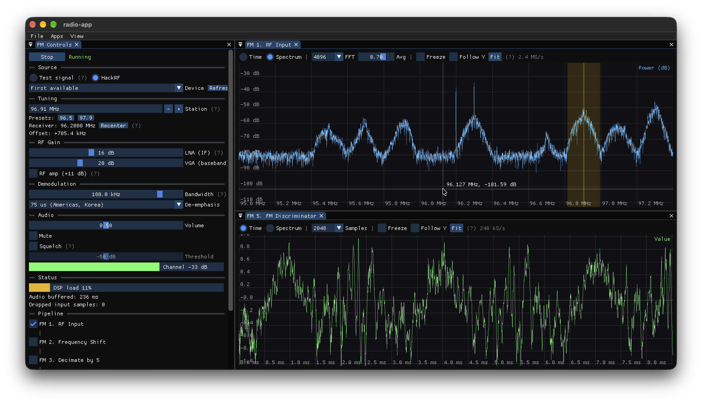
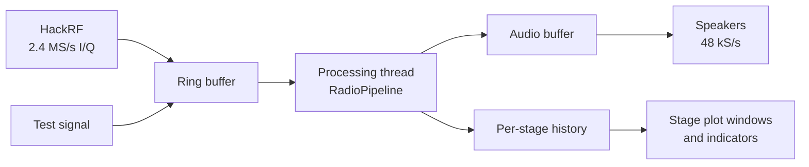
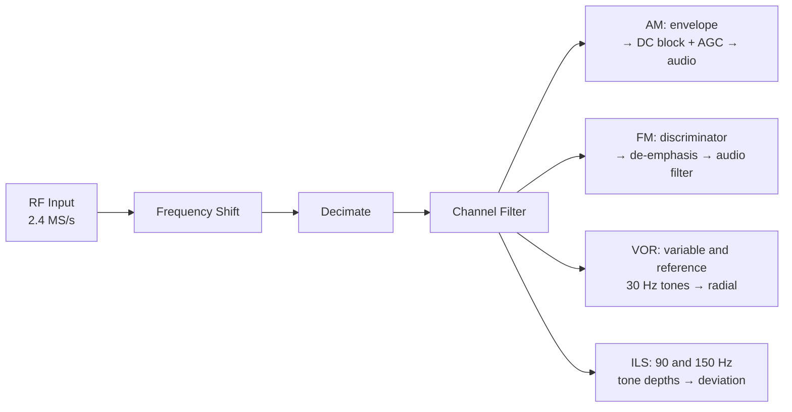
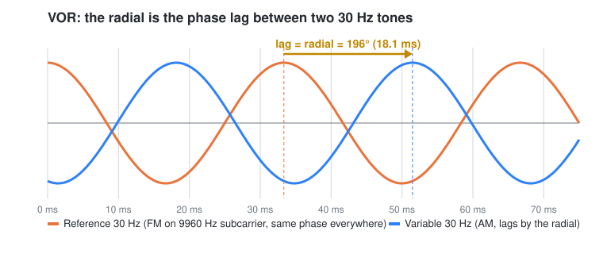
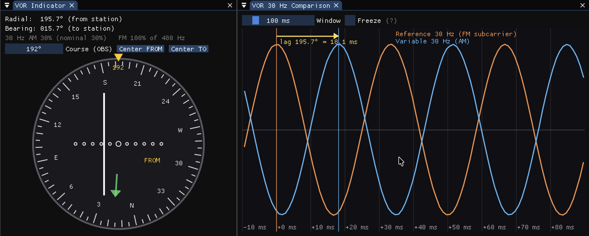
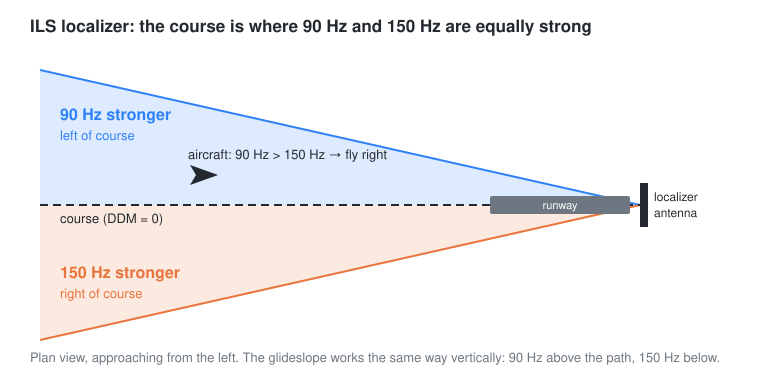
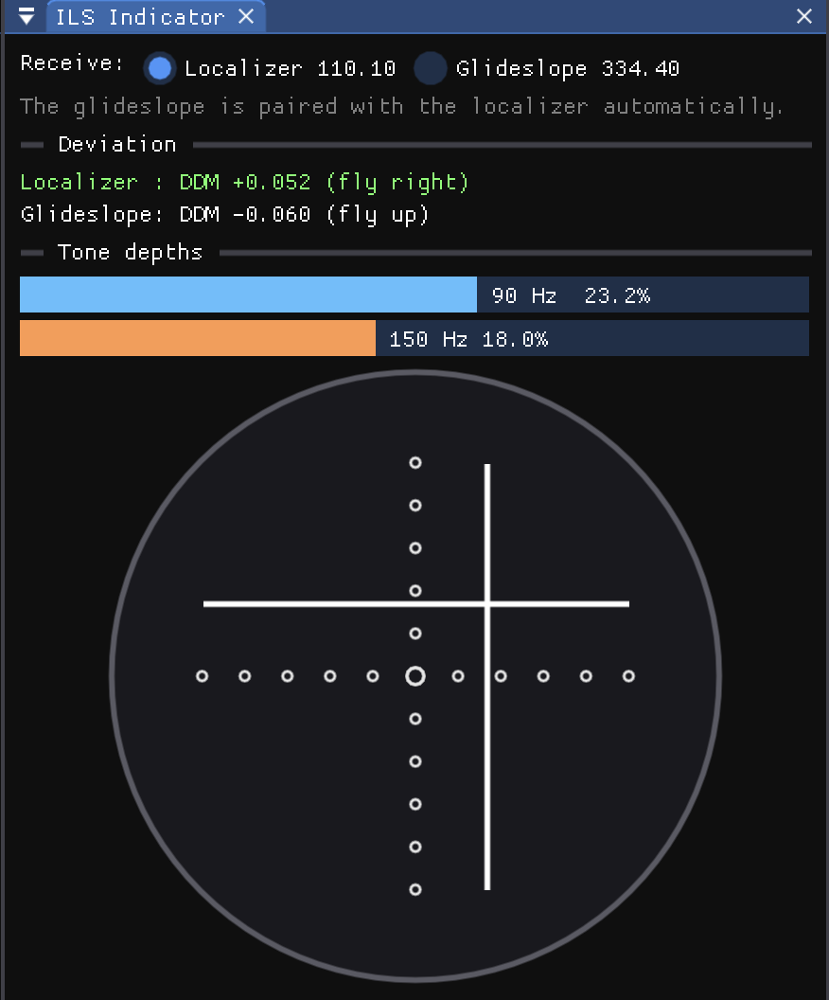

# LTB Radio

A software-defined radio (SDR) playground for the [HackRF One](https://greatscottgadgets.com/hackrf/).
Every step of each receiver's signal processing chain is shown live in its own window, so you can
watch a radio signal turn into audio or a navigation reading.

Built with C++23, Vulkan and Dear ImGui.



## Apps

Pick one from the **Apps** menu. Each opens a set of dockable windows, toggled from the **View**
menu or the app's Controls window.

| App          | What it receives                                                                   |
|--------------|------------------------------------------------------------------------------------|
| **HackRF**   | Lists connected HackRF devices and their details.                                  |
| **AM Radio** | Amplitude modulation, defaulting to the aviation band (ASOS weather, CTAF, ATC).   |
| **FM Radio** | Broadcast FM (88–108 MHz), mono.                                                   |
| **VOR**      | VHF omnidirectional range navigation beacons: measures your radial from a station. |
| **ILS**      | Instrument landing system localizer and glideslope deviation.                      |
| **Test App** | Viewport and rendering tests.                                                      |

Every radio also has a **Test signal** source that simulates stations, so all of it works without
hardware.

## How it works

Samples flow from the HackRF (or the test signal) through a processing thread to the speakers,
while the GUI reads the latest output of every stage.



Each radio shares the same front end: shift the tuned station to 0 Hz, then filter and decimate
down to the channel. What happens next depends on the modulation.



### Stage windows

Every stage in the chain has its own plot window:

- **Time** or **Spectrum** view, with adjustable sample count, FFT size and averaging.
- Drag to pan. Scroll to zoom time or frequency; **Alt**+scroll zooms amplitude and **Ctrl**+scroll
  zooms both. Double-click to fit.
- **Right-click a spectrum to tune to that frequency.** The tuned channel is highlighted.
- **Freeze** to hold the picture.

### VOR

A VOR transmits two 30 Hz tones. The reference tone has the same phase in every direction; the
variable tone lags it by the bearing from the station. The **30 Hz Comparison** window overlays
both, locked to a reference peak, and the **VOR Indicator** shows the result on a course deviation
indicator with an adjustable course (OBS).





### ILS

The localizer and glideslope each carry 90 Hz and 150 Hz tones whose strengths depend on which
side of the course or glide path you're on. The difference in depth of modulation (DDM) drives the
needles on the **ILS Indicator**. Charts list only the localizer frequency; the paired glideslope
is looked up from the FAA AIM table automatically.





The HackRF can only receive one of the two at a time (they're over 200 MHz apart), so the
indicator switches between them and holds each needle's last reading.

## Building

Requirements:

- A C++23 compiler and CMake 3.23+
- The [Vulkan SDK](https://vulkan.lunarg.com/)
- `pkg-config` and `libusb` for HackRF support:
  - macOS: `brew install pkg-config libusb`
  - Ubuntu: `sudo apt install pkg-config libusb-1.0-0-dev`

Other dependencies (ImGui, GLFW, libhackrf, miniaudio, GoogleTest, and
[ltb-vlk](https://github.com/LoganBarnes/ltb-vlk)) are downloaded by
[CPM](https://github.com/cpm-cmake/CPM.cmake) when CMake configures.

### Build and run

No submodules needed. CMake downloads ltb-vlk at the commit the `ltb-vlk` submodule pins, so
clone with git (not a zip download) so that commit can be looked up.

```sh
git clone https://github.com/LoganBarnes/ltb-radio.git
cmake -S ltb-radio -B ltb-radio/build -DCMAKE_BUILD_TYPE=Release
cmake --build ltb-radio/build --config Release --target radio-app
./ltb-radio/build/src/ltb/apps/radio-app
```

The app path includes the configuration (e.g. `apps/Release/radio-app`) with multi-config
generators such as Ninja Multi-Config or Xcode.

### Development

Turn on the tests and strict warnings (every warning is an error):

```sh
cmake -S . -B build -G "Ninja Multi-Config" \
  -DLTB_RADIO_BUILD_TESTS=ON \
  -DLTB_RADIO_USE_STRICT_FLAGS=ON
cmake --build build --config Debug
ctest --test-dir build -C Debug
```

Signal processing is compiled with optimizations even in Debug builds so it keeps up with
real time. Setting `CPM_SOURCE_CACHE` (e.g. `~/.cache/CPM`) shares downloads between build
directories.

#### Editing ltb-vlk

Only needed when changing [ltb-vlk](https://github.com/LoganBarnes/ltb-vlk) itself. Check out the
submodule and point CPM at it instead of the downloaded copy:

```sh
git submodule update --init
cmake -S . -B build -DCPM_LtbVlk_SOURCE=$PWD/ltb-vlk
```

Everyone else builds the commit the submodule pins, downloaded from GitHub. So push ltb-vlk
changes before committing the updated submodule in this repo, or other builds will fail to find
that commit.

## Links

- [Great Scott Gadgets: Software Defined Radio with HackRF](https://greatscottgadgets.com/sdr/)
- [HackRF documentation](https://hackrf.readthedocs.io/)
